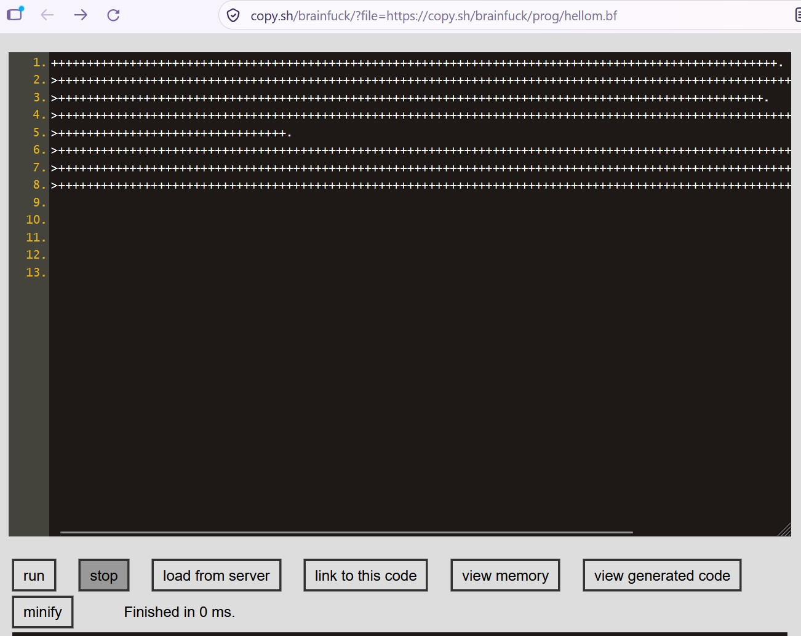

<h3>Bf programs in Python...</h3>

Brain f..ck programs:
<ul>
<li> Hello world. </li> 
<li>Fibonacci-numbers (0,1,1,2,3,5,8,13,21,34). </li>
<li>Sierpinsky codes.</li>
</ul>
 
Output:  
 
Hello World! 
1, 1, 2, 3, 5, 8, 13, 21, 34, 55, 89 
Add something to 3 (e.g., 4): 
3 
6 

